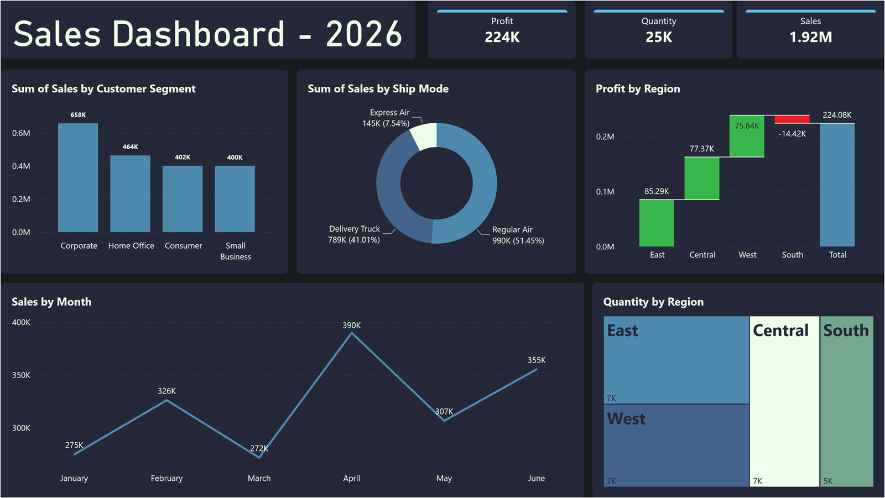

# Sales Dashboard 2026

A single-page Power BI sales dashboard covering revenue, profit, quantity, regions, customer segments, and shipping modes.



## Overview

| Item | Detail |
|---|---|
| Tooling | Power BI Desktop, DAX, native visuals |
| Layout | Single-page sales report |
| Measures | Sales, Profit, Quantity |
| Dimensions | Region, Customer Segment, Ship Mode, Order Date |

## What the dashboard shows

- **Three KPI cards** - total sales, profit, and quantity.
- **Sales by customer segment** - revenue split across Corporate, Home Office, Consumer, and Small Business.
- **Sales by ship mode** - share of revenue by shipping method.
- **Profit by region** - waterfall view of regional profit contributions.
- **Sales by month** - monthly revenue trend across the first half of the year.
- **Quantity by region** - treemap of unit volume concentration.

## Repository contents

```text
sales-dashboard-2026/
|-- Sales_Dashboard_2026.pbix
|-- assets/
|   `-- dashboard.png
`-- README.md
```

## How to open

1. Open `Sales_Dashboard_2026.pbix` in Power BI Desktop.
2. Use the report filters and slicers to narrow the view by region, segment, or shipping mode.
3. Hover over each visual for exact values.

## Data notes

- The report is self-contained; its illustrative data is embedded in the PBIX.
- Figures are illustrative and are not tied to a real company.

## Author

**Mohamed Mahmoud Taha** - Financial Analyst | Data Analyst

GitHub: [momahmoud02](https://github.com/momahmoud02)
